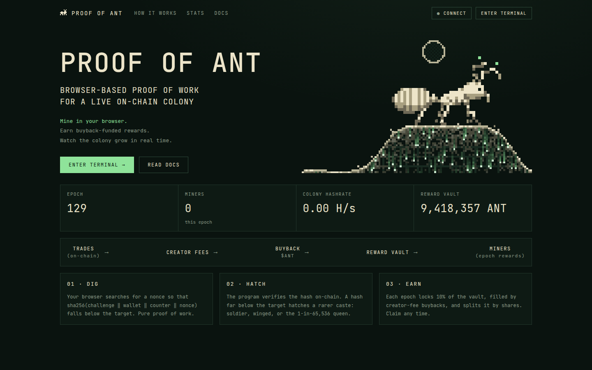
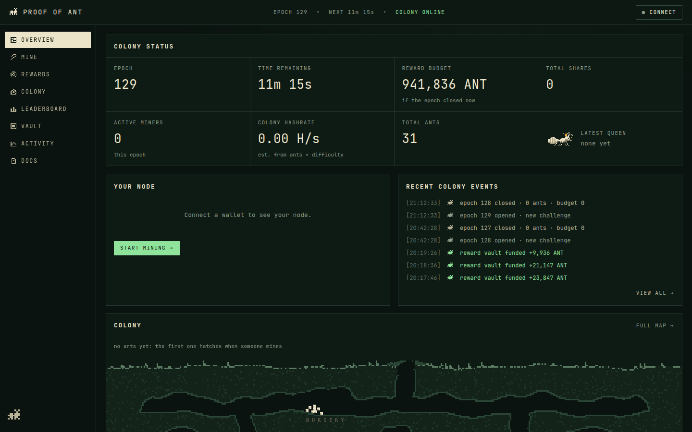
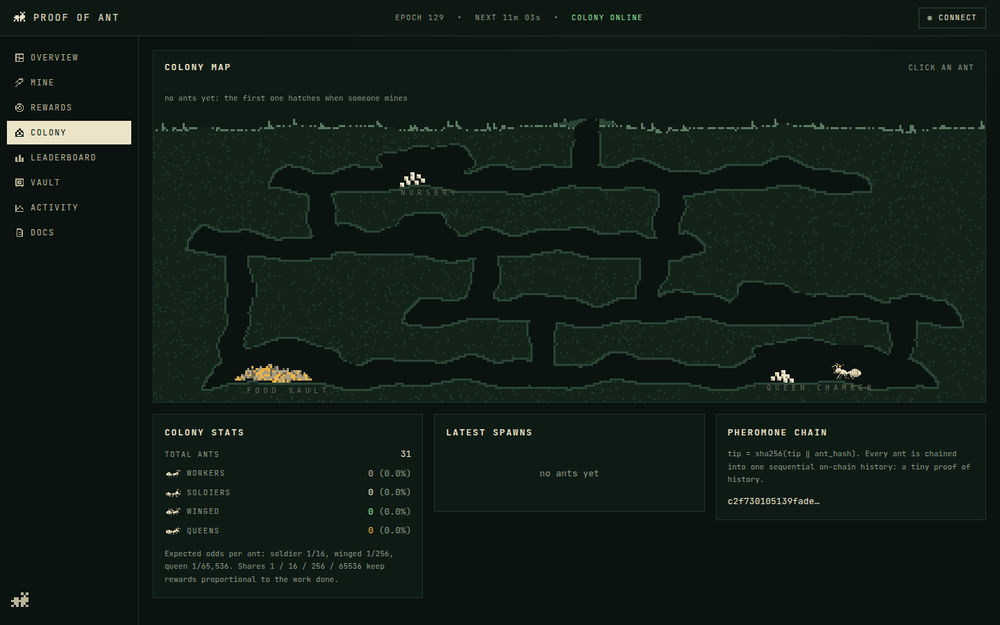

<p align="center">
  
</p>

<h1 align="center">Proof of Ant</h1>

<p align="center">
  Browser proof of work for a living on-chain ant colony on Solana.<br>
  Hash in your browser, hatch ants on-chain, share the rewards bought back with creator fees.
</p>

<p align="center">
  <a href="https://proofofant.fun"><b>proofofant.fun</b></a>
  ·
  <a href="#how-it-works">How it works</a>
  ·
  <a href="#run-it-locally">Run it locally</a>
</p>

<p align="center">
  
  
  
  
</p>



## How it works

**Mining.** Every epoch the program publishes a random challenge (from recent slot hashes).
Miners search for a nonce such that

```
h = sha256(challenge ‖ wallet ‖ counter ‖ nonce)
```

starts with a number below the epoch's target. The search runs in Web Workers in the browser;
the program re-checks the hash on-chain with `sol_sha256` and hatches an ant. Your wallet and a
per-miner counter are part of every hash, so a solution can't be stolen, replayed or reused.

**Castes.** The further below the target a hash lands, the rarer the ant. Shares grow with
rarity at the same rate as the odds shrink, so the expected reward always tracks the work done.

| Caste | Extra leading zero bits | Shares | Odds |
|---|---|---|---|
| Worker  | 0  | 1      | most ants |
| Soldier | 4  | 16     | 1 in 16 |
| Winged  | 8  | 256    | 1 in 256 |
| Queen   | 16 | 65,536 | 1 in 65,536 |

**Epochs and rewards.** When an epoch ends, anyone can crank it closed. A slice of the reward
vault becomes that epoch's budget and is split by shares; miners claim it within the claim
window. The vault is filled by buying the token back with the creator fees.

**Difficulty.** The target retargets every epoch towards the desired number of ants, at most
×2 easier or ÷2 harder per step, with a floor so a quiet colony never becomes trivial.

**Pheromone trail.** Every ant is chained into `colony.tip`, a sequential on-chain hash chain:
a tiny proof of history of the whole colony.

**No wallet popups while mining.** One approval authorises a browser session key that
signs the `dig` transactions; rewards are still paid to your wallet only.

**Anti-sybil.** Mining requires holding a minimum balance of the token, and each wallet can
hatch a capped number of ants per epoch.

<p align="center">
  
  
</p>

## Program

`programs/proof-of-ant`: an Anchor program, `6XpBQEvCBfx4WM1iGDpUyFGkGXVTXXxcp7pvV6uZEhUU`.

| Instruction | Who | What |
|---|---|---|
| `init_colony`     | authority   | colony for a token mint, its reward vault and epoch 0 |
| `set_session`     | miner       | authorise a session key to sign digs |
| `dig`             | miner / session | submit a nonce, verify the hash, hatch an ant |
| `advance_epoch`   | anyone      | close the epoch, set its budget, retarget, open the next |
| `claim`           | miner       | collect rewards for a closed epoch |
| `expire_epoch`    | anyone      | release unclaimed rewards back to the vault pool after the claim window |
| `deposit_rewards` | anyone      | feed the vault (buybacks) |
| `set_params`      | authority   | tune epoch length, targets, emission, limits |

Works with both classic SPL tokens and Token-2022 (pump.fun coins).

## Repository

```
programs/proof-of-ant   Anchor program (Rust)
tests/                  integration tests (mocha + tsx)
app/                    Next.js frontend: miner, colony map, rewards, leaderboard
scripts/                colony setup, epoch crank, params
deploy/                 server setup: systemd services, nginx, deploy script
art/                    pixel-art sprites and the tools that build them
```

## Run it locally

Requirements: Rust, Solana CLI 2.1, Anchor 0.31, Node 22+.

```bash
npm install && (cd app && npm install)
anchor build && npm run sync-idl      # program + IDL for the frontend
npm run local:validator               # terminal 1: local chain with the program
npm run local:setup                   # once: mint, colony, vault food, app/.env.local
npm run local:crank -- --buybacks     # terminal 2: closes epochs, simulates buybacks
cd app && npm run dev                 # terminal 3: http://localhost:3000
```

In the app: **Connect → Dev burner wallet**, then **Dev faucet** in the wallet menu,
then **Mine → Start mining**.

## Deploy

**Program and colony** on a public cluster (`CLUSTER=devnet` shown, mainnet works the same):

```bash
npm run devnet:deploy                     # needs ~2.5 SOL on .keys/dev.json
MINT=<token mint> npm run devnet:setup    # colony on an existing token → app/.env.devnet
CLUSTER=devnet EPOCH=1800 npx tsx scripts/set-params.ts   # tune a live colony (authority)
```

Without `MINT`, setup creates a test token. With it, the initial vault food comes from what
the dev wallet holds.

**Site and crank** on a server (Ubuntu or Debian):

```bash
scp deploy/* root@host:/tmp/poa/ && ssh root@host bash /tmp/poa/server-setup.sh
# fill /etc/proof-of-ant.env (see deploy/env.example), add the crank key
deploy/deploy.sh root@host
```

The browser talks to the site's own `/api/rpc` proxy, so a keyed RPC URL stays on the server.
The app needs no websockets or `getProgramAccounts`, so free RPC tiers work: it confirms
transactions by polling, follows events by polling signatures and derives receipts as PDAs.
The crank runs with its own funded key, never the program's upgrade authority.

## Tests

```bash
anchor test                   # 12 integration tests on a local validator
TOKEN_2022=1 anchor test      # the same suite on a Token-2022 mint
cargo test -p proof-of-ant    # unit tests: castes, retarget
```

## Toolchain notes

- platform-tools v1.43 ships rustc 1.79, so the lockfile is pinned for it
  (`rust-version = "1.79"`, `blake3 = 1.5.5`). Regenerate with
  `CARGO_RESOLVER_INCOMPATIBLE_RUST_VERSIONS=fallback cargo generate-lockfile`
  and pin blake3 again.
- Keys live in `.keys/` (git-ignored); the global Solana config is untouched.

## License

[MIT](LICENSE)
